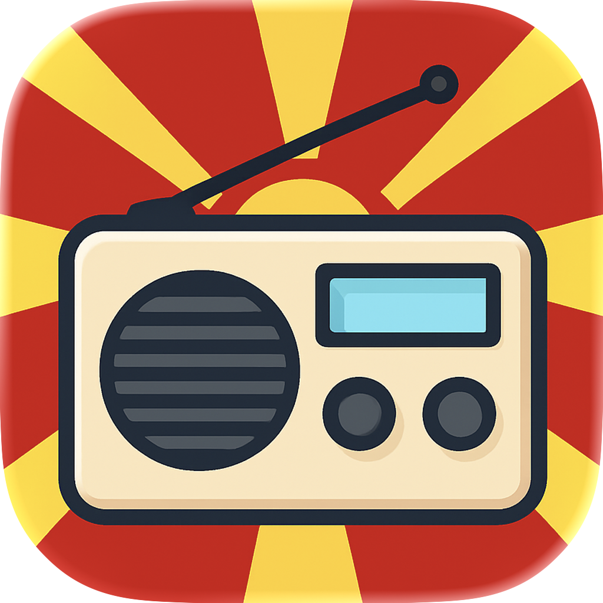

# 👋 Hi, I'm Davor Denikj

Staff Software Engineer building scalable SaaS platforms, mobile apps, and cloud infrastructure.

---

## 🚀 What I’m working on

### 🇩🇪 Deutschland Heute

🌐 https://www.deutschlandheuteapp.de

Native iPhone app for everyday life in Germany, live on the App Store

- Public holidays, school breaks, and bridge days for all 16 federal states
- Sun times, nearby fuel prices, quote of the day, and this day in history
- Home-screen widgets
- One-time Pro upgrade with no subscription

**Tech**

---

### 🍅 TomatoCards (SaaS)

🌐 https://tomatocards.com

Digital business card platform (B2C + B2B)

- Custom domains & branding
- Subscription model
- Mobile wallet integration

**Tech**

---

### 📻 MK Live Radio

🌐 https://mkliveradio.app

Mobile app streaming 80+ Macedonian radio stations

- iOS + Android
- Firebase Analytics + AdMob

**Tech**

---

## 🧠 Core Expertise

- Backend: .NET, Minimal APIs, Clean Architecture, API & SDK Design
- Mobile: Swift (iOS), Xamarin, MAUI
- Cloud: Distributed systems, container orchestration (Kubernetes), cloud platforms (Azure), CI/CD pipelines (GitHub Actions, Azure DevOps), Infrastructure as Code
- Auth: Keycloak, Zitadel
- Product: SaaS architecture, subscription systems, mobile applications

---

## 🌐 Portfolio

- https://davordenikj.com

---

## 🤝 Let’s connect

- LinkedIn: https://linkedin.com/in/davordenikj

Open to backend / platform engineering discussions and interesting product ideas.
